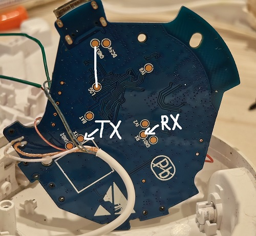

# RTL8763BF dumper

A simple tool, reverse-engineered (and fast-vibecoded :p) from the official Realtek MPPGTool for dumping BootROM and flash. Tested only on JBL Tune 510BT and not guaranteed to work with other headphones with the same or similar chipsets.

## Why not just use the official MPPGTool?

1. For some reason, the MPPGTool couldn't connect to my Tune 510BT.
2. Because of the first problem, it's unclear whether the read operation even works (especially since it was hidden behind a "internal" launch argument).
3. It can't read BootROM (and my dumper can).

## Connecting to UART on Tune 510BT

1. Disassemble the right earcup.
2. Not necessary, but it's recommended to unsolder the battery pins.
3. Unscrew and flip the circuit board over.
4. Set the UART adapter to 1.8V.
5. Solder the LOG pin to any GND pin. Solder to the UART (in crossover) and GND for UART adapter. The photo below shows what to do and how to do it.
6. Don't forget to unsolder the LOG pin after dumping (if you want to keep using them, of course :D).

<details>


</details>

## Usage

First of all, install pyserial:
```bash
pip install pyserial
```

Flash dump:

```bash
python rtl-dump.py COM<yourport> -o mydump.bin
```

BootROM dump:

(you may need to run this command several times)

```bash
python rtl-dump.py COM<yourport> -o myromdump.bin --rom
```

Help message:
```bash
python rtl-dump.py
```

## Support

If this was helpful to you, you can help me too — support my research with a donation!

<p>
  <a href="https://boosty.to/nnonick" target="_blank"></a>
</p>

## License

GPLv3